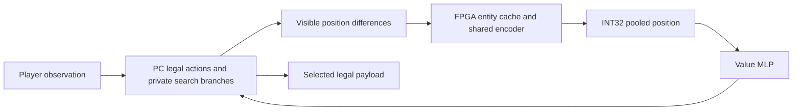

# Pokémon TCG position evaluator and DE10-Lite co-design

Updated November 12, 2026. The selected architecture is an NNUE-style incremental Deep Sets position evaluator on the DE10-Lite, PC search, and direct small-model training on ASU Sol. The [main plan](openjev-tcg-adaptation-plan.md) defines the data, search, protocol, training, and acceptance contracts. This document summarizes the hardware/software design. LSTM models remain excluded.

## Runtime architecture



The host agent exposes `choose(observation, history) -> selected_indices`. Its evaluator backend supports full synchronization, saved positions, atomic changes, evaluation, and restoration. The same search runs against integer software and the board. Sol supplies trained/exported weights.

The simulator owns legality and transitions. The PC owns hidden-world sampling, permitted observation/history construction, instance IDs, change detection, branch simulation, and action selection. The FPGA computes the complete learned encoder/value model, maintains group sums, and restores evaluator states. The PC retains simulator and history snapshots in parallel with saved FPGA positions.

Use `V(observation, history)` as the expected final match return for a fixed observer, with win `+1`, loss `-1`, and draw `0`. Preserve observer perspective across consecutive subdecisions and opponent turns. A terminal match uses the actual result. At a nonterminal search cutoff, use the learned value of the observer-visible position.

## Model baseline

| Part | Shape |
| --- | --- |
| Card/entity encoder | `16 -> 16 ReLU -> 16 ReLU` |
| Four typed group sums | Own board, opposing public board, own hand, public discards; 16 values each |
| Global context and history | 32 global + 32 permitted-history features |
| Value head | `128 -> 64 ReLU -> 1` |

The deployed model has **8,768 weights + 97 biases = 8,865 parameters**. INT8 weights and INT32 biases require **9,156 bytes** before buffers/metadata. The fixed-summary value MLP is the comparison baseline. The earlier candidate-policy MLP remains an optional training aid for PPO.

Features preserve active/bench roles, owner/zone, attachments, known mechanics, and unknown markers. Attached Energy and Tools contribute through the parent Pokémon. Public stadium/effect and selection context need explicit global representation. Stable card serials support instance identity despite hand/bench index changes. Encode permitted information at every search node. [CABT API](https://matsuoinstitute.github.io/cabt/api.html)

Sum only real entities and preserve repeated-card counts. Mask padded vectors after encoding. Pooling produces fixed width as entity counts vary. Audit feature collisions and the maximum supported count against the selected engine/card pool. Keep model, feature order, normalization, and history/reset conventions in the export manifest.

## Full and incremental evaluation

A full synchronization encodes all visible entities, initializes four INT32 group sums, and stores exact quantized entity outputs. The value MLP receives the requantized pools plus current global/history values.

An update removes old cached contributions and adds newly encoded ones. For a hand Energy attachment:

```text
hand'  = hand - cached_phi(Energy)
board' = board - cached_phi(Pokemon_before) + phi(Pokemon_after)
```

The same transaction updates counts, attachment-use flags, history, selection context, and every affected entity. Local features support reuse. Effects that alter several entity features require several replacements. Cached encodings are keyed by instances and encoding version. [Stockfish incremental accumulator reference](https://github.com/official-stockfish/Stockfish/blob/edb0d9db6731067ec50ce619ff372b463bc4dd5d/src/nnue/nnue_accumulator.cpp)

Keep the pool sums before clipping/rounding. Subtract the exact cached output, including encoder bias effects, then add the new output. Requantize the resulting sums for each value evaluation. Under identical model/features, full and incremental integer paths must agree exactly.

### Proposed command contract

| Command | Responsibility |
| --- | --- |
| `SYNC` | Complete root build with model/schema/observer/game identity |
| `PUSH` | Save active cached entities, group sums, globals/history, and position identity |
| `APPLY` | Validate base token; atomically commit additions, removals, replacements, and context changes |
| `EVAL` | Return committed position value and cycle counts |
| `POP` | Restore the parent, including all removed/replaced entities and non-entity inputs |

Allow one active position and one outstanding command. Results identify request, model, and position and remain stable until acknowledged. Session epochs detect reset. Recognized duplicate requests return the recorded completion without repeating mutations. An uncertain completion, lost cache lineage, or partial failure requires a root resynchronization. Loading a new model invalidates active and saved states.

Use complete snapshots first. Prototype 128 entity entries and eight saved states. Approximate packed storage per state is `16*E + 8*E + 256 + 64` bytes plus headers. At 128 entities, the active state and eight snapshots require approximately 30,528 bytes before banking/padding. Profile on-chip snapshot/restore cycles. An undo journal is a later alternative if these copies dominate. Detect overflow before mutation. Stack depth can be managed by host scheduling or rebuilding supported positions. Entity-table overflow needs a larger fitted capacity or an explicitly logged integer-software fallback for the complete decision.

## Arithmetic and RTL budget

Use signed INT8 input/weight ranges `[-127,127]`, INT8 ReLU outputs `[0,127]`, INT32 biases/dot-product accumulators, and INT32 pool sums. Export power-of-two nonnegative right shifts, round-to-nearest ties-to-even, saturation, and a common INT32 output scale. Widen rounding temporaries. The host converts final output to return units and clips to `[-1,1]` consistently across software and FPGA search.

Prove `abs(bias) + fan_in*127*127 <= 2^31-1` per neuron and group/update bounds from the audited entity capacity. Quantization-aware training must match pool and layer rescaling. Store the full numeric contract and golden vectors with the weight image.

One entity encoding needs 512 multiply-accumulates and one value-head call needs 8,256. Begin with one reused lane, then fit four lanes working on different output neurons. Broadcast activations and bank weights by output index modulo four.

| Operation | Four-lane ideal multiply-issue cycles | Time at assumed 50 MHz |
| --- | --- | --- |
| Encode one changed entity | 128 | 2.56 microseconds |
| Value head | 2,112 | 42.24 microseconds |
| One changed entity + value | 2,240 | 44.80 microseconds |
| Full 64-entity rebuild + value | 10,304 | 206.08 microseconds |

These estimates exclude pool/cache operations, snapshots, RAM/control stalls, rescaling, simulator work, and transfers. Packed weight banks contain 2,240, 2,176, 2,176, and 2,176 bytes, suggesting 12 weight-only M9Ks in 1024-by-8 mode. Every other buffer and controller is additional.

The board provides MAX 10 logic, M9K memory, embedded multipliers, and USB-Blaster. Use on-chip weights/state and the JTAG-to-Avalon bridge with a tested local Quartus/System Console installation. MAX 10 multiplier hardware and LE-based accumulation require separate fit accounting. [Terasic board specifications](https://www.terasic.com.tw/cgi-bin/page/archive.pl?CategoryNo=218&Language=English&No=1021&PartNo=2), [M9K layouts](https://docs.altera.com/r/docs/683431/current/max-10-embedded-memory-user-guide/memory-configurations-for-dual-port-modes), [multiplier architecture](https://docs.altera.com/r/docs/683467/current/max-10-embedded-multipliers-user-guide/embedded-multipliers-operational-modes), [JTAG bridge](https://docs.altera.com/r/docs/683271/current/customizable-flash-programmer-user-guide/configuring-jtag-to-avalon-master-bridge-ip-core)

The RTL blocks are dense compute, requantization/ReLU, entity cache, pool arithmetic, snapshot RAM, command controller, JTAG registers/buffers, and cycle counters. Snapshot and delta commands operate on committed tokens so search can return to a valid parent.

## Search and training integration

Start PC search with equal-sample root rollouts under explicit hidden-card priors and observation-based continuation policies. Try every supported root payload in complete rounds and aggregate leaf/terminal values. Restore both simulator and FPGA parent state before each alternative. Measure one, two, and four samples per candidate, with rollout horizon and wall-time caps. Use a legal heuristic fallback if the budget expires before any complete round. Report root coverage and fallback outcomes.

The first pilot must verify engine branching, state reconstruction, chance sampling, and private observations. A later Information Set MCTS comparison can share statistics across observationally indistinguishable histories. Its information boundary and branching implementation need their own audit. The [main plan](openjev-tcg-adaptation-plan.md) specifies the initial search and extension boundaries.

Train the encoder and value head directly on completed-match outcome labels, retaining wins/losses/draws. Start with audited replays or heuristic matches. Then alternate frozen-model search-guided matches with value regression on new and earlier training positions. Keep match-grouped splits and held-out seed schedules. The optional PPO experiment adds a training policy head and uses actor-sampled action probabilities. Choose checkpoints using complete-match search performance.

Use Sol CPU jobs for simulator collection and evaluation, and profile CPU versus one GPU for learning. Save optimizer/RNG/model/data/search versions and persistent completed-match shards. Sol allocation access and the native simulator environment still need a compute-node pilot. [ASU resource requests](https://docs.rc.asu.edu/requesting-resources/)

## Verification and milestones

1. Establish legal baseline matches, reproducible private simulator branches, data examples, and a JTAG register/buffer echo.
2. Train the fixed-summary and Deep Sets value models and establish CPU search with a fixed validation workload.
3. Run complete integer positions through encoder/pools/value RTL and the physical board.
4. Add delta transactions and saved positions. Verify attachment, restore, and two different child branches against complete recomputation.
5. Integrate FPGA evaluation into PC search, then run search-guided data collection/model updates on Sol.
6. Freeze the selected model/search settings and run held-out gameplay, resource, and timing comparisons.

Verify rounding, saturation, extreme inputs, empty pools, repeated cards, capacity bounds, hand-index shifts, changed global effects, reveals, BO3 game resets, and nested snapshots. Test duplicated commands, stale tokens, timeouts, partial failure, and lost responses. Check both accumulators and final values after legal action traces, including every restore.

Compare floating-point software, integer software, full-rebuild FPGA, and incremental FPGA using the same model, search configuration, and root workload. Report update, encoder, pool, value, sync, and snapshot/restore cycles. Report full observation-to-selection p50/p95/max, sample counts, evaluated nodes, root coverage, refresh/fallback rates, transfer costs, and full-match decision time. Include fixed-work and fixed-wall-time search comparisons with match-level uncertainty and frozen opponent/seed schedules.

Retain the provisional 100 ms p95 complete-decision engineering target. Implementation evidence determines realistic search work per decision. The initial Python evaluator, native-game collector, attachment checks, and CPU value-training baseline now run locally; see the [prototype instructions](README.md#running-the-python-prototype). Search helpers, audited mechanic features, Sol account/QoS, local Quartus, course deadline, and required competition variant remain execution inputs.
