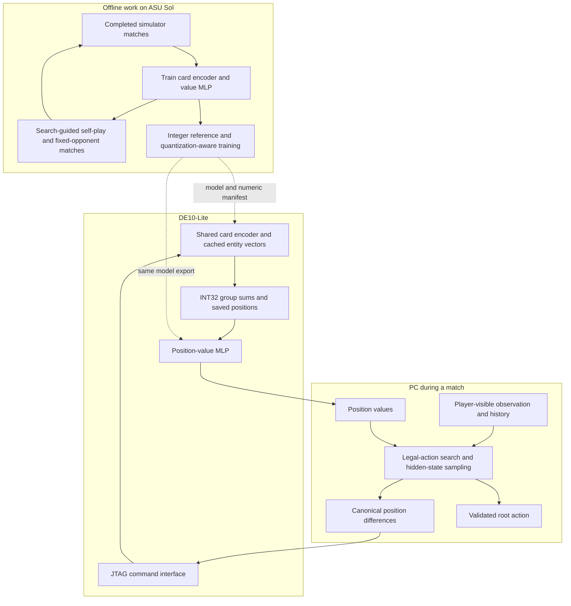

# NNUE-style Deep Sets position evaluator

Current project plan, November 12, 2026. Target hardware is the DE10-Lite, search runs on the PC, and training runs on ASU Sol. The selected model is a shared card encoder with incrementally maintained group sums and a position-value MLP. The initial Python model/cache, native-game collection, and CPU value-training baseline are implemented and exercised locally. The [prototype instructions](README.md#running-the-python-prototype) and [API evidence](kaggle-api-implementation-research.md) describe their scope. Sol training, simulator search branching, hardware fit, and end-to-end search timing remain implementation milestones. LSTM and recurrent variants remain excluded at the user's request.

## Selected system and caller contract

The host agent exposes `choose(observation, permitted_history) -> selected_indices`. It constructs a player-visible root position, explores legal continuations in the simulator, requests position evaluations, and returns the engine payload for the chosen root action.

The FPGA implements `evaluate(position_token) -> value`. It retains learned card encodings and group sums between related positions. The host can rebuild a complete position, apply a change set, save a position, and restore it after a search branch.



Stockfish's NNUE implementation maintains feature accumulators as positions change and supplies evaluations to search. This project adopts that separation and incremental computation using learned card vectors. Its Deep Sets encoder computes each vector from structured card facts. [Stockfish accumulator source, release 19](https://github.com/official-stockfish/Stockfish/blob/edb0d9db6731067ec50ce619ff372b463bc4dd5d/src/nnue/nnue_accumulator.cpp)

The proposed Kaggle submission uses the same PC search with integer software evaluation. The local demonstration substitutes FPGA evaluation. Keep the simulator, search budget, observation boundary, numeric model, and selection handlers matched across the comparison.

## Ownership and position representation

| Component | Owns |
| --- | --- |
| CABT engine | Game transitions, legal options, chance events, selection constraints |
| PC adapter | Player-visible facts, history, instance identity, numeric encoding, simulator branches, legal payloads |
| PC search | Belief samples, continuation policies, budget, aggregation, root selection |
| DE10-Lite evaluator | Learned entity encoder, cached vectors, group sums, snapshots, value MLP, cycle counts |
| Sol jobs | Data collection, model updates, validation matches, quantization/export |

Use one observer player for an evaluation request. Define `V(o, h) = E[Z_observer | visible observation o, permitted history h]`, with terminal match return `+1` for a win, `-1` for a loss, and `0` for a draw. Values retain that observer's perspective throughout a search branch. Consecutive simulator selections can belong to the same player, so a subdecision does not automatically flip a value's sign.

The canonical position includes engine/card-pool version, match/game IDs, observer, model/schema/normalization IDs, entity instances and groups, global features, and history summaries. Host instance IDs derive from stable card serials and their represented role, rather than hand or bench array offsets. Candidate indices remain local execution payloads. [CABT state, serials, selections, and events](https://matsuoinstitute.github.io/cabt/api.html)

Start with Playground, one fixed player deck, the pinned match format, and several opponent decks/policies. Audit metadata and card mechanics before freezing the feature schema. Public stadium effects and current selection context need explicit global features. Record unknown mechanics and representation collisions. Engine replay access, branching support, and compatible card data still need inspection.

## Model and feature budget

| Part | Provisional shape | Meaning |
| --- | --- | --- |
| Entity features | 16 values per entity | Card/mechanic category, owner/zone/active flags, HP/status, evolution and attachments |
| Shared encoder `phi` | `16 -> 16 ReLU -> 16 ReLU` | One learned 16-value vector per entity |
| Four grouped sums | `4 * 16 = 64` values | Own board, opposing public board, own visible hand, public discards |
| Global facts | 32 values | Turn/use flags, counts, visible match score, stadium/effect/selection context |
| Permitted history | 32 values | Deterministic visible-event summaries with game/match reset rules |
| Value MLP `rho` | `128 -> 64 ReLU -> 1` | Expected match return from pooled 64 + global 32 + history 32 |

The shared encoder and value MLP train together. Deep Sets motivates a shared entity transformation followed by permutation-invariant pooling. Preserve owner, zone, active status, and attachment relationships in the facts supplied to this project adaptation. [Deep Sets](https://arxiv.org/abs/1703.06114)

Represent attached Energy and Tools in the parent Pokémon's features. Repeated hand or discard cards contribute repeated entities. Include ownership in the public-discard representation. Hidden opponent hand identities, unrevealed prizes, and future draws remain outside the encoded position. Unknown counts can still be global facts.

Local entity features make reuse possible. If a global effect changes an entity's encoded damage, status, or resource facts, include that entity in the change set. Keep global counts, selection context, and history in their separate inputs where appropriate. The host compares canonical features at each evaluated boundary, so it catches changes beyond the most recent named event.

Variable entity counts are supported through shared encoding and sums. Empty groups contribute zero. In batched training, mask padded entities after encoding so bias terms also contribute zero. Audit supported entity capacity and stream complete positions within it. Training should cover the relevant counts, targets, effects, and search positions.

### Size and arithmetic

| Model | Matrix weights | Biases | Parameters | INT8 weights + INT32 biases |
| --- | --- | --- | --- | --- |
| Fixed-summary value MLP `128 -> 64 -> 1` | 8,256 | 65 | 8,321 | 8,516 bytes |
| Deep Sets encoder plus value MLP | 8,768 | 97 | **8,865** | **9,156 bytes** |
| Optional training policy head `160 -> 64 -> 32 -> 1`, additional | 12,320 | 97 | 12,417 | 12,708 bytes |

The deployed evaluator budget is the 8,865-parameter row. An optional policy head is an auxiliary training experiment and would need an explicit export/resource update if later deployed. No learned embeddings are included in these counts. Feature widths remain subject to the mechanic audit.

An entity encoding requires 512 multiply-accumulates. One value-head evaluation requires 8,256. For four output-neuron lanes, ideal multiply-issue cycles are `128*C + 2,112` for `C` new or changed entities and one evaluation. Removing an entity uses its cached vector. At an assumed 50 MHz, one changed Pokémon plus one value evaluation gives **44.8 microseconds** of multiply issue time. A full rebuild of 64 entities plus evaluation gives **206.08 microseconds**. Pooling, RAM, control, snapshot/restore, rescaling, simulator work, and JTAG costs are additional. These are arithmetic estimates.

## Incremental position maintenance on the FPGA

For group `g`, retain `A_g = sum(phi(entity))` as an INT32 vector before pool rescaling. Cache each real entity's exact quantized encoder output. Initialize a game or a fresh model by building the complete visible position.

| Change | Cache/accumulator operation |
| --- | --- |
| Add entity | Encode it, add its vector to its group, retain it |
| Remove entity | Subtract its cached vector and invalidate the entry |
| Replace facts or change group | Subtract the old cached vector, encode new facts, add to the destination group, replace entry |
| Global/history change | Replace those inputs and recompute the value MLP |

An ordinary Energy attachment from hand to a Pokémon produces:

```text
hand_sum_new  = hand_sum_old - cached_phi(Energy_in_hand)
board_sum_new = board_sum_old - cached_phi(Pokemon_before)
                              + phi(Pokemon_after)
```

The PC also updates hand count, the manual attachment flag, selection context, history, and any triggered changes. The Energy's attached contribution is included in the updated Pokémon features. CABT exposes attachment events, card serials, and `energyAttached`. [CABT attachment and state interface](https://matsuoinstitute.github.io/cabt/api.html)

Apply all changes for a resolved engine transition as one transaction. Evaluation begins after the complete transaction commits. A replace always subtracts the previously cached vector, including its learned bias contribution, and adds the newly computed vector. This allows incremental and complete recomputation to agree exactly.

Cache validity depends on model weights, schema, normalization, observer, game context, and entity facts. Changing any encoding convention or model requires rebuilding the position. Resets, missing updates, unknown state tokens, and detected disagreement trigger a complete host resynchronization.

## Search on the PC

### First search implementation

Begin with bounded root-action rollouts and the learned leaf evaluator. This creates a measurable search/evaluation system before adding a larger tree policy.

The first searched contexts require exactly one choice and have at least two legal options. A fixed-deck handler covers initial deck selection, and forced moves bypass search. Optional-empty, multi-selection, and order-sensitive contexts use deterministic tested host handlers with recorded coverage and outcomes. Expand learned/search coverage by constructing complete legal payloads or a selected-prefix policy after auditing those semantics. The same handlers apply to CPU and FPGA comparisons.

1. Capture the observer's real observation/history and enumerate every supported legal root payload.
2. Generate hidden-world/chance samples consistent with permitted information. Use the same sample schedule across root alternatives where possible.
3. Save the root simulator state and FPGA position. Apply one candidate in a private simulator branch.
4. Continue with frozen observation-based policies for both players. The initial horizon is one completed turn by each player, capped by simulator transitions and wall time. Stop and evaluate only at a resolved decision boundary. Use terminal match results directly when available.
5. Build the observer-visible leaf facts, apply their differences to the FPGA, and evaluate. Return to the saved root before trying another candidate.
6. Average returns/leaf values by root candidate. Complete an equal-sample round across all candidates before using that round for selection. Keep the best completed round when the budget expires. If none finishes, return the legal heuristic fallback and record the cause.

Start with one sample per candidate, then profile two and four samples. A 64-entry transport buffer is a batching size, and every candidate remains in the supported root set. Report incomplete rounds, fallback rate, and the count of root actions actually evaluated. A provisional p95 observation-to-selection target of 100 ms guides the pilot; set usable rollout depth and counts from measurements.

The CABT pilot must prove reproducible branching/restoration and a supported way to instantiate sampled hidden worlds. Record the actual API and information exposed by it. If the supplied API cannot provide those operations correctly, build the required simulator adapter or scope the experiment to the supported interface and document the resulting limitation before scaling.

### Hidden information and tree extension

Root samples come from the observer's known cards, public history, counts, and an explicit prior over compatible unknown cards/decks. Private simulation state is used by the rules engine. Every continuation policy receives its own permitted observation, and the value encoder receives the fixed observer's permitted leaf observation. Actual hidden cards from the live match and future random seeds cannot supply privileged policy inputs. Audit branches in which a card becomes revealed and branches that end a BO3 game.

The initial root-rollout method is a belief-sampled policy-evaluation approximation. Record its prior, opponent assumptions, sample count, and sampling uncertainty. A later Information Set MCTS experiment can share search statistics across indistinguishable histories. Its implementation must address observation identity, chance sampling, and whose information is used at each choice. Sampling a fully specified world alone can allow strategy fusion. [Information Set Monte Carlo Tree Search](https://eprints.whiterose.ac.uk/id/eprint/75048/1/CowlingPowleyWhitehouse2012.pdf)

Compare root rollouts and any tree extension under both fixed evaluation counts and fixed wall time. Keep model version, observer perspective, search configuration, and history in value-cache keys. A tree policy that changes which states it evaluates also changes the data distribution the value model must cover.

## State save, restore, and host protocol

Use one active FPGA position and a LIFO stack of saved positions. The first implementation saves complete evaluator states on chip. This makes restoration explicit and has a predictable memory cost. An undo journal is an alternative to measure if snapshot cost becomes significant.

| Command | Contract |
| --- | --- |
| `SYNC` | Build a complete root with model/schema/observer/game IDs, entity instances, globals, and history; return a fresh position token |
| `PUSH` | Save active cache, group sums, globals/history, and position identity; return parent token |
| `APPLY` | Validate base token and a bounded change set, atomically commit a child position, return child token |
| `EVAL` | Return value for the requested committed token with model ID, request ID, and cycle counts |
| `POP` | Restore the saved parent, including removed/replaced entities and all non-entity inputs |

The PC owns simulator snapshots, belief samples, and history branches. FPGA snapshots contain only evaluator state. After returning from a branch, restore both sides to the same parent token. Histories and global flags are part of each branch even when entity sums match. Search hypotheses that produce different visible facts need matching cache updates. At a real game boundary, build the next game's root and reset game history while preserving only permitted match facts.

Use a monotonically identified session/reset epoch, unique request IDs, one outstanding command, and stable results until acknowledgment. A completed duplicate request with the same payload returns its recorded result without applying the mutation again. If command completion is uncertain and cannot be queried, abandon that evaluator context and `SYNC` the current root. A partial failure invalidates the position. Model changes invalidate every saved frame.

Provisional capacities are 128 active entity entries and eight saved frames, subject to engine audit and fit. A packed active state needs `16*E` cached-vector bytes, about `8*E` metadata bytes, 256 bytes of group sums, and 64 global/history bytes, plus command/state headers. At `E=128`, that is approximately 3,392 bytes per state and 30,528 bytes for the active state plus eight saved copies. RAM banking and padding add overhead. Snapshot depth is a hardware working limit; the PC can rebuild or schedule branches within it. Check capacity before mutation and preserve a valid root on overflow.

An exhausted snapshot stack can be handled by restoring/rebuilding supported positions under a different branch schedule. A position exceeding active entity capacity requires a larger audited hardware configuration or an integer-software fallback for that complete decision. Record these fallback decisions and exclude them from FPGA-served coverage. Rebuilding the same oversized entity set cannot resolve an active-table capacity limit.

## Training directly on ASU Sol

### Data and initial value training

Pin engine/card-pool versions, deck configuration, match format, baseline opponents, and source versions. Audit roughly 20 complete replays if available and a pilot of about 100 locally generated matches. Card metadata supplies feature facts; completed matches supply return labels. Keep wins, losses, and draws.

Store immutable raw player-visible positions, history, observer, match/game IDs, final observer result, source/seed provenance, collection-policy/search version, selection context, and legal payloads. Record intermediate evaluated positions and transitions so both training coverage and incremental deltas can be audited. Label a sampled training-world trajectory using that world's eventual outcome. Leaf estimates used inside search are recorded as estimates; completed played-match returns are the initial training targets.

Deduplicate replay copies and group both players and all BO3 games by complete match. Use a provisional 80/10/10 train/validation/final-test split. Identical observations can legitimately have different outcomes; retain or aggregate those targets with sample counts instead of treating every difference as a corrupt label. Fit normalization and quantization calibration on training data. Reserve final-test match/seed schedules throughout later collection.

Train the fixed-summary value baseline and the Deep Sets value model using three seeds each. For one observed position, compute all entity encodings, group sums, and `V(o,h)`, then minimize squared error to the terminal match return. Backpropagation updates the shared encoder and value head together. Start with AdamW, learning rate `1e-3`, weight decay `1e-4`, batches of 128 positions, and validation early stopping, then tune from the pilot. Overfit a small audited subset before scaling to 100,000 usable positions if available. These are proposed experiment budgets.

### Search-guided self-play and reinforcement learning

The main improvement loop uses completed-match Monte Carlo value learning:

```text
freeze evaluator k and collection opponents/search
  -> play matches using CPU search with evaluator k
  -> retain observer-visible positions and final returns
  -> fit evaluator k+1 on a mixture of new and earlier training matches
  -> evaluate k+1 with the deployed search procedure on validation seeds
  -> retain the strongest validated checkpoint and repeat
```

Start with equal sampling of new and earlier match data and equal sampling of fixed baselines and frozen previous agents, then measure the effect. Freeze collection policies within a round. Test the value model at the resolved positions and horizons used by search. Record return prediction error, calibration by predicted-value bins, complete-match quality, and collection cost. No monotonic gameplay improvement is assumed.

PPO remains an optional comparison. Add the earlier candidate policy head, sample moves from that actor, and train it jointly with the shared encoder and value head using recorded actor probabilities and advantages. Export the encoder/value subset for the search evaluator. Search-selected moves require an explicit search-policy training design; ordinary actor PPO ratios cannot be obtained by attaching actor probabilities to actions selected by a different search procedure. The [model-method research](model-options-research.md) provides background, and the original PPO paper defines that procedure. [PPO](https://arxiv.org/abs/1707.06347)

### Sol execution and recovery

Run simulator collection and evaluation on CPU compute allocations. Profile four to eight independent workers first. Train one model on CPU or one x86-64 NVIDIA allocation, choosing the learner device from throughput. Sol supports separate CPU/memory and GPU requests, subject to account/partition/QoS access. [ASU resource requests](https://docs.rc.asu.edu/requesting-resources/)

Use independent seed/job trials before distributed learning. Assign each collection shard one writer and a distinct training seed range. Keep important data/checkpoints on persistent storage. Save weights, optimizer/scheduler, RNG states, model/schema/normalization IDs, collection-search/opponent versions, and training counters. Resume at completed-match boundaries if simulator state cannot be restored exactly. Quantization/export jobs record the full numeric manifest and golden full/incremental traces. No Sol job has been launched as part of this planning update.

## Integer model and RTL implementation

Use signed INT8 input/weights in `[-127,127]`, INT32 biases/dot-product accumulators, and INT8 ReLU encoder outputs in `[0,127]`. Retain group sums as INT32. Requantize pooled channels with exported power-of-two right shifts only when feeding the value head. Rounding is nearest with ties to even and saturation, using a widened rounding temporary. Final raw INT32 values share one scale. The PC converts them to expected-return units and clips to `[-1,1]` for the search leaf-value contract.

The exporter proves `abs(bias) + fan_in*127*127 <= 2^31-1` for every dot product and `E_group_max*127` for pool accumulation, including update temporaries. It records cache layout, group membership, instance-ID mapping, pool and layer scales, shifts, model/schema/normalization IDs, and rounding. Model weights and numeric conventions remain fixed during a search. Quantization-aware fine-tuning includes sums and pool rescaling. Validate the exported model under full-match search as well as position error. [Integer inference and QAT](https://arxiv.org/abs/1712.05877)

Use a reusable dense engine for the entity encoder and value layers, on-chip banked weights, a cached-vector table, four 16-channel pool accumulators, saved-state RAM, a controller, and counters. Prototype one arithmetic lane, then fit four output-neuron lanes. Packed four-bank weight sizes are 2,240, 2,176, 2,176, and 2,176 bytes, suggesting **12 weight-only M9Ks** in 1024-by-8 mode. Biases, cache, saved positions, activation buffers, interface, and logic are additional. Actual fit and timing require Quartus. [M9K configurations](https://docs.altera.com/r/docs/683431/current/max-10-embedded-memory-user-guide/memory-configurations-for-dual-port-modes), [MAX 10 multipliers](https://docs.altera.com/r/docs/683467/current/max-10-embedded-multipliers-user-guide/embedded-multipliers-operational-modes)

Connect through the onboard USB-Blaster using a JTAG-to-Avalon bridge and a local tested Quartus/System Console installation. Measure root sync, deltas, snapshot/restore, and evaluation transfer costs separately. Model weights stay resident. [Board specifications](https://www.terasic.com.tw/cgi-bin/page/archive.pl?CategoryNo=218&Language=English&No=1021&PartNo=2), [JTAG bridge](https://docs.altera.com/r/docs/683271/current/customizable-flash-programmer-user-guide/configuring-jtag-to-avalon-master-bridge-ip-core)

## Milestones and acceptance evidence

| Stage | Deliverable | Evidence to advance |
| --- | --- | --- |
| A. Simulator and board pilot | Engine baseline, sampled-world branching/restoration audit, Sol throughput, JTAG echo | Legal complete matches, valid information boundary, reproducible private branches, measured transfer costs |
| B. Value model | Fixed-summary and Deep Sets value checkpoints | Match-grouped data, return targets, three-seed validation and CPU search baseline |
| C. Full FPGA evaluator | Integer reference, encoder/pools/value RTL, `SYNC`/`EVAL` | Exact outputs in simulation and on board, fitted resources and timing |
| D. Incremental state | Entity cache, transactional `APPLY`, `PUSH`/`POP` | Exact full/delta/restore trace agreement, reset/retry/capacity tests |
| E. Search and learning | PC search with FPGA calls; value-learning self-play rounds | Complete matches, consistent parent restoration, measured search coverage and validation comparison |
| F. Final benchmark | Frozen model, opponents, seeds, search configuration, report | Match quality with uncertainty, full latency/cost breakdown, resources and reproducible traces |

The first vertical slice is one legal Energy attachment represented in software, followed by identical full and incremental value outputs. The first hardware slice sends a position through `SYNC`/`EVAL`, then applies that attachment and restores the parent. Follow with two alternative branches from the same root. Use deterministic test weights while training proceeds. A non-improving learning round is recorded and the best validated checkpoint proceeds to deployment.

## Final experiments

Compare the heuristic, fixed-summary value search, floating-point Deep Sets search, integer-software search, FPGA full-rebuild search, and FPGA incremental search. Match decks, host handlers, opponent pool, seed schedules, and numerical output conversion. Use both seats where supported and BO3 match-level uncertainty. Select models/search/quantization settings using validation, then freeze final test. Measure policy coverage and unsupported-context outcomes.

Verify entity permutation invariance, repeated-card counts, empty pools, every capacity boundary, hand-index shifts, changed global effects, attachments, reveals, game resets, and nested branch restoration. Test duplicate commands, partial failure, stale epochs, and a lost response. After random legal action traces, full software, incremental software, RTL, and board must return identical quantized accumulators and values at checkpoints. Keep golden boundary/rounding/saturation vectors.

Report encoder, pool, value-head, snapshot/restore, and sync cycles, with actual clock and Quartus/TimeQuest results. Wall time begins at observation receipt and includes history/features, hidden-world construction, simulator transitions, every JTAG operation, search bookkeeping, and final legal selection. Report p50/p95/max, sample count, evaluated positions, candidate/entity/change counts, cache refreshes, fallbacks, deadline misses, and time per match. Use both fixed-work and fixed-time CPU/FPGA comparisons. The provisional 100 ms p95 goal is a project target. Physical card-state acquisition remains a separate requirement for physical-match use.

## Planned implementation areas and open dependencies

| Area under `project/` | Responsibility |
| --- | --- |
| `agent/adapter.py`, `agent/features.py` | CABT observations, legal payloads, history, canonical position and change sets |
| `agent/search.py` | Root sampling/rollouts, opponent policies, budget, root aggregation |
| `agent/evaluator.py` | Full and incremental integer reference; software/FPGA command contract |
| `training/` | Match collection, value training, optional PPO, validation, integer export |
| `sol/` | Profiled CPU collection, learner, evaluation, and export Slurm jobs |
| `hardware/`, `host/` | Dense/pool/cache/snapshot RTL, Quartus project, protocol, board benchmark |
| `models/`, `results/` | Small exports, manifests, golden traces, match/timing/resource results |

The first model/feature/cache implementation and runnable attachment tests now occupy `agent/` and `energy_attachment.py`. Initial native game collection and value training are the top-level `collect_matches.py` and `train_baseline.py` entry points. The remaining table entries are implementation milestones. External inputs still needed for full execution are the course deadline/required competition variant, audited card mechanics and search helper bundle, Sol allocation details, and a local tested Quartus workstation. The [hardware co-design plan](architecture-and-training-plan.md) summarizes the selected baseline, while the [Open-Jev source review](openjev-source-research.md) remains historical SDK research.
